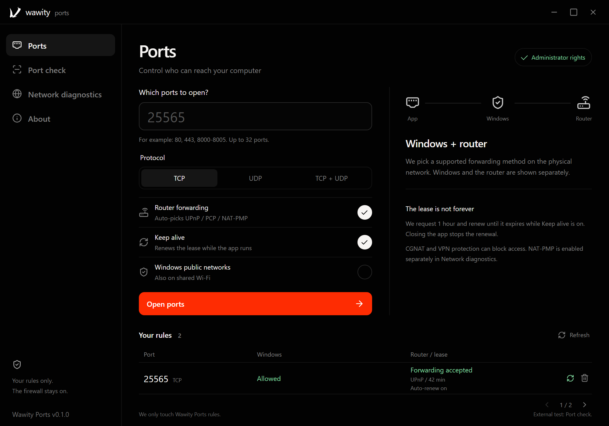

# Wawity Ports

**Wawity Ports** — a Windows utility for open ports: inbound Windows Firewall rules and router port forwarding via UPnP, PCP or NAT-PMP, with automatic lease renewal and real Internet reachability checks. A portable EXE with no installer — part of the Wawity ecosystem ([wawity.lol](https://wawity.lol)).



🇷🇺 Русская версия: [README.ru.md](./README.ru.md)

🛠 Part of the Wawity ecosystem: VPN client — [Wawity/wawity-desktop](https://github.com/Wawity/wawity-desktop).

---

## Contents

- [Getting started](#getting-started)
- [Usage](#usage)
- [Leases and auto-renewal](#leases-and-auto-renewal)
- [Network diagnostics](#network-diagnostics)
- [Diagnostics and log](#diagnostics-and-log)
- [Temporary test server](#temporary-test-server)
- [Interface language](#interface-language)
- [Telemetry (beta)](#telemetry-beta)
- [Building without an installer](#building-without-an-installer)
- [Testing](#testing)

## Getting started

Ready to run: `src-tauri/target/release/wawity-ports.exe`.

Launch the EXE and confirm the administrator prompt. Requires Windows 10/11 with the Microsoft Edge WebView2 Runtime; the app does not install WebView2 for you. Keep the EXE in a writable folder: it creates `wawity-ports-state.json` next to itself to track forwards. Move that file together with the EXE when relocating.

## Usage

1. Enter ports, e.g. `25565`, `80,443` or `8000-8005` (up to 32 unique ports).
2. Pick TCP, UDP or both.
3. Keep «Port forwarding» and «Keep alive» enabled for automatic forwarding with renewal.
4. Click «Open ports». Windows and router results are shown separately; detailed system messages may be in English.
5. Use the delete button on a rule to remove both the Windows rule and the app-owned forward.

By default inbound connections are allowed only in private and domain networks. Public networks require a separate toggle with confirmation. Do not open ports you don't use: every open port increases exposure of the service to other devices.

The app never disables the firewall and never touches foreign rules or forwards. Closing the window does not remove rules. Windows rules are permanent. When opening, the app chooses a supported mapping protocol itself: previously saved, then UPnP, PCP and — only with explicit consent — NAT-PMP. After an ambiguous router response it does not retry with another protocol, to avoid creating a duplicate forward.

## Leases and auto-renewal

Router forwards are always requested for one hour; permanent mappings are never created. With «Keep alive» enabled the app renews the lease around the middle of its lifetime while the app is running. Renewal pauses when the Windows rule is missing, the router state changed, the machine woke up on a different network, or the granted lease is too short. The rules table shows the method (`UPnP`, `PCP`, `NAT-PMP`), remaining time and renewal state; the circular-arrows button toggles renewal per rule. Closing the app or shutting down stops renewal; once a lease expires the forward disappears on the router.

NAT-PMP cannot verify who owns a record, so it is only enabled with explicit consent in «Network diagnostics» and may replace another program's mapping on the same internal port of this computer. UPnP and PCP are the defaults.

A created rule does not prove Internet reachability: that needs a running server, router support, a suitable NAT and provider permission. CGNAT, double NAT, provider blocks and Windows rules can interfere.

## Network diagnostics

The «Network diagnostics» view shows the physical LAN address and gateway, global IPv6 addresses (without opening the IPv6 firewall) and the gateway's actual answers to UPnP, PCP and NAT-PMP. No answer means "unconfirmed", not "unsupported". Diagnostics never creates or deletes anything. 20 seconds after the main view opens the app refreshes the rules table to reflect the current auto-renewal state.

## Diagnostics and log

The «Check ports» view inspects up to 8 ports: listening TCP servers and UDP sockets with their binding addresses, app-owned Windows rules and saved forwards. Opening ports triggers an automatic local check with no external requests; more than 8 ports skips auto-diagnosis with an explanation.

External TCP checks are opt-in: the router IP and selected ports are submitted to check-host.net and its nodes. This is not a NAT loopback test from the same machine. Private/CGNAT addresses are skipped, and service errors never count as a closed port. UDP reachability requires an answer from the specific application.

The check keeps a verdict per port/protocol with a timestamp: reachable, no listener, loopback only, local only, UDP unverified, externally unconfirmed or unknown. Several verdicts are paginated. External TCP is selected by default but only sent after confirmation. A positive TCP test proves reachability of the public IP:port, not the identity of the program behind it.

## Temporary test server

Enable «Temporary TCP server», pick exactly one free port and confirm the launch with an external check. Create the rule/forward on the main view first: the test does not create them. The mode is unavailable for UDP-only and never replaces an existing service.

The diagnostic server listens only on the selected physical IPv4 LAN address, runs up to 70 seconds (including one external retry) or 64 connections, and closes itself after the check, an error or the deadline. It reads no client input, sends no content and executes nothing; accepted sockets are closed immediately.

The verdict «Test server reached externally» requires a successful external TCP test matching the probing node's public IP, time and local endpoint with an accepted connection. Without the match it reports «Test access unconfirmed», even if the public port answered somewhere. It is correlation, not a cryptographic challenge. After the test the server is stopped — run your game or program for real sessions.

The log is saved next to the EXE as `wawity-ports.log`; the previous log rotates at 1 MB. «Copy» copies the full result, «Open log» opens the file in Notepad. The bottom panel hides after 15 seconds (paused on hover/focus); the last result can be reopened from the sidebar.

UPnP binds only to the physical LAN interface: the multicast egress and HTTP source IP are selected explicitly. New records store the verified UPnP endpoint for removal without an SSDP search; legacy records still need discovery. The app never disables VPN, kill switches, adapters or protective rules — if your VPN blocks the LAN, interface binding bypasses nothing.

## Interface language

The interface ships in English (default) and Russian; the switch lives on the About page and persists. Verdict titles/details and system messages come from the Rust backend and are currently Russian; English backend verdict texts are planned for the next release.

## Telemetry (beta)

During the public beta, telemetry stays mandatory: it reports only two things — successful port openings and errors. No IPs, ports or traffic content. It exists to catch firmware quirks across real routers and is sent through the same relay the Wawity client uses. It becomes optional after beta.

## Building without an installer

You need Node.js, Rust MSVC and the Visual Studio C++ Build Tools.

```powershell
npm install
npm run build:portable
```

The frontend is embedded into the EXE; no NSIS/MSI is produced. To preview the UI in a browser run `npm run dev`; system operations are disabled in that mode.

## Testing

```powershell
$env:WAWITY_PORTS_TEST_MODE='1'
cargo test --manifest-path src-tauri/Cargo.toml
```

The variable lets debug tests run without UAC; release builds always require administrator. The parser tests never touch the network or firewall.

Verified on a real TP-Link EC220-G5 (AC1200, 2019+ web UI): the tests include a real end-to-end port opening confirmed from 4 external regions.
